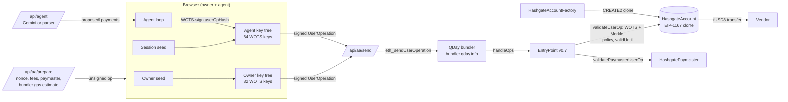
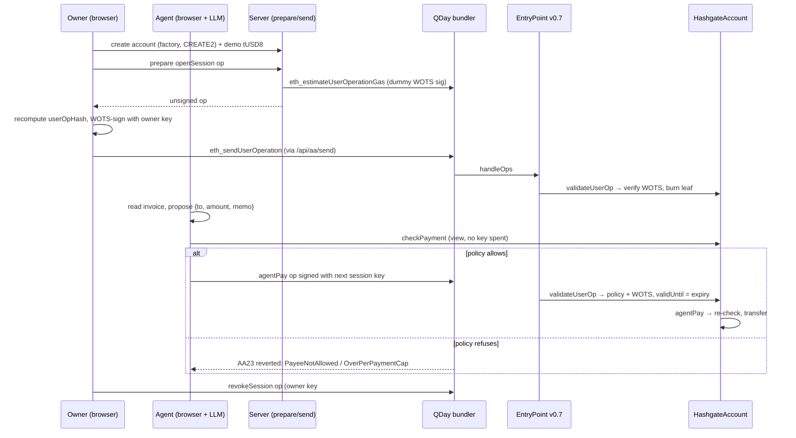

# Hashgate

**Post-quantum ERC-4337 smart accounts for AI payment agents on QDay Aevum.**

Hashgate gives an AI agent a tUSD8 budget inside an ERC-4337 smart account whose every
UserOperation is authorised by a **hash-based one-time signature (WOTS) over the `userOpHash`,
verified in `validateUserOp`**, not by ECDSA. The owner sets a per-payment cap, a total budget,
an expiry and a payee allowlist; the account enforces them during validation, so QDay's bundler
refuses a bad payment before it is ever included. Gas is sponsored by a paymaster, and the owner
can revoke the agent instantly.

| | |
|---|---|
| Live demo | **https://hashgate-three.vercel.app** (no wallet needed) |
| Demo video | https://youtu.be/kcW9YxvPOIw (2:20, narrated; ERC-4337 version) |
| Pitch deck | https://hashgate-three.vercel.app/deck ([PDF](media/hashgate-deck.pdf)) |
| Bundler | QDay's own `https://bundler.qday.info` (rundler, ERC-7562 safe mode), EntryPoint v0.7 |
| Account factory | [`0x54cd8d534c187bf9d6db8a37c7b45e3ad1444b21`](https://explorer-test.qday.info/address/0x54cd8d534c187bf9d6db8a37c7b45e3ad1444b21) |
| Paymaster | [`0x48de838a3d18f8965edf8cb5db2517a92375809f`](https://explorer-test.qday.info/address/0x48de838a3d18f8965edf8cb5db2517a92375809f) |
| Track | Native AI Assistants (Aevum Builder Challenge #1) |

---

## Why

- **Agents hold keys that do too much.** Most agent wallets hand the model a private key or an
  ECDSA session key. A prompt injection or a leaked env var can move the whole balance.
- **ECDSA has an expiry date.** secp256k1 falls to Shor's algorithm on a large quantum computer
  ("Q-Day"). Every public key already on-chain can be harvested now and forged later.
- **QDay is a post-quantum chain.** Hashgate moves the authorisation itself onto hash-based
  signatures — inside a standard ERC-4337 account, through QDay's own bundler, no precompile
  or new opcode needed.

Every other agent-wallet design we know of, including session-key smart accounts, still
authorises the agent with ECDSA. Hashgate's guardrails hold even against an attacker who has
every ECDSA key in the system.

## What you can do in the demo

1. **Create a smart account** — the browser derives 32 one-time owner keys from a fresh seed; the
   factory deploys an ERC-4337 account (EIP-1167 clone) owned by their Merkle root. A demo
   treasury drips 0.05 tUSD8. No wallet, no gas.
2. **Open an agent session** — choose cap, budget, expiry, allowed payees. The owner signs one
   UserOperation with one WOTS key (2,144-byte signature); it goes through the QDay bundler and
   the paymaster pays the gas. The agent gets its own tree of 64 keys and may only call `agentPay`.
3. **Run the AI payables agent** (Gemini) over an inbox of four invoices. With *"assume the model
   is compromised"* on, it obeys a hidden instruction in one invoice. Result: two invoices paid by
   agent-signed UserOperations, the over-cap invoice blocked (`OverPerPaymentCap`), the injected
   redirect blocked (`PayeeNotAllowed`). Any refusal can be signed and pushed through
   `EntryPoint.handleOps` to leave a reverted tx on the explorer
   (`FailedOpWithRevert(0, "AA23 reverted", PayeeNotAllowed(0xBaD…))`).
4. **Try to break it** — the Q-Day drill signs a UserOperation to drain the account as an attacker
   who holds every ECDSA key (`AA24`, bad signature) and replays a real agent operation
   (`LeafAlreadyUsed`). Revoke the session and run the agent again (`SessionIsRevoked`).
5. **Activity** — every account, session and payment event with explorer links.

## Architecture





### ERC-4337 contracts (`contracts/src/aa/`)

- **`HashgateAccount.sol`** — EntryPoint v0.7 account. `signature = abi.encode(role, sessionId,
  OTS)`; the WOTS key signs the `userOpHash` itself.
  - *Owner role*: any call (open/revoke sessions, `execute`, rotate the owner key).
  - *Session role*: only `agentPay(sessionId, to, amount, memo)`. Validation checks that the
    session exists and isn't revoked, the payee is allowed, the amount is under the cap and the
    budget; it then returns the session expiry as **`validUntil`**, so the EntryPoint enforces
    expiry without a `TIMESTAMP` read. `agentPay` re-checks everything at execution time.
  - A wrong signature returns `SIG_VALIDATION_FAILED` (bundler: `AA24`) without burning a leaf;
    a reused leaf reverts `LeafAlreadyUsed`.
  - **ERC-7562 safe mode**: validation reads and writes only the account's own storage, uses no
    banned opcodes, and nonce key 0.
- **`HashgateAccountFactory.sol`** — CREATE2 EIP-1167 clones, deterministic address from
  `(owner key commitment, salt)`; no storage, usable from `initCode` unstaked.
- **`HashgatePaymaster.sol`** — sponsors gas only for Hashgate accounts: it checks
  `keccak256(sender.code)` against the clone code hash (no storage, so no stake needed) and caps
  the cost per operation. Its admin key only manages the gas deposit.

Measured on Aevum through the bundler: owner `openSession` ≈ 431k gas, agent `agentPay`
≈ 270k–312k, `revokeSession` ≈ 253k (all including the ~200k WOTS verification).

### v1: direct-relay vault

The first version (`contracts/src/Hashgate.sol`, [`0x699d…3674`](https://explorer-test.qday.info/address/0x699d045bb5acfe677e7b0a44257eb4c9a5c73674))
keeps the same WOTS keys and policy in a single vault contract submitted by a relayer. It is
still deployed and documented below; the app now uses the ERC-4337 accounts.

### Shared library and v1 vault (`contracts/src/`)

- **`WOTS.sol`** — library. Winternitz OTS with n = 32 bytes, w = 16 (67 hash chains), keccak256
  with a per-call tweak `leaf<<16 | chain<<8 | step` (no multi-target attacks), leaf compression,
  and Merkle-path folding. Hand-written assembly with a scratch buffer: one signature check is
  ~1,000 keccak calls.
- **`Hashgate.sol`** — vaults and sessions. No admin, no ECDSA owner, no upgrades, `msg.sender`
  is never used for authorisation.

| Function | Signed by | What it does |
|---|---|---|
| `createVault(Key, salt)` | — | Commits an owner key tree. Signing nothing grants nothing. |
| `deposit` / `depositWithAuthorization` | ERC-20 approve / EIP-3009 | Funds a vault. The EIP-3009 nonce is bound to the vault id, so a relayer can't redirect it. |
| `openSession(vault, Key, Policy, OTS)` | owner key | Registers an agent key tree + cap / budget / expiry / payees. |
| `pay(session, to, amount, memo, OTS)` | agent key | Policy checks, then WOTS verify, burn the leaf, transfer. |
| `revokeSession(session, OTS)` | owner key | Kills the session immediately. |
| `withdraw(vault, to, amount, OTS)` | owner key | Moves funds out. |
| `rotateOwnerKey(vault, Key, OTS)` | owner key | Moves the vault to a fresh owner tree when keys run low. |
| `checkPayment(session, to, amount)` | view | Returns a reason code, so agents refuse before spending a key. |

Every digest includes a domain separator `keccak256("Hashgate v1", chainId, address(this))` and an
operation tag. Custom errors: `BadSignature`, `LeafAlreadyUsed`, `SessionIsRevoked`,
`SessionExpired`, `OverPerPaymentCap`, `OverBudget`, `PayeeNotAllowed`,
`InsufficientVaultBalance`, …

**Gas on Aevum** (measured, 1 gwei): `pay` ≈ 238k–270k, `openSession` ≈ 374k, `revokeSession`
≈ 176k, `createVault` ≈ 115k. A post-quantum agent payment costs about **0.0003 tQDAY**.

### SDK (`packages/sdk`, `@hashgate/sdk`)

Reusable TypeScript, independent of the web app:

```ts
import { KeyTree, randomSeed, domainOf, payDigest, verifyOTS, hashgateAbi, aevum } from "@hashgate/sdk";

const agent = KeyTree.fromSeed(randomSeed(), 6);          // 64 one-time keys
const key = agent.commitment();                          // { pubSeed, root, height } → openSession
const domain = domainOf(44005, HASHGATE);
const digest = payDigest(domain, sessionId, vendor, 5_000n, memo);
const ots = agent.sign(0, digest);                       // { leafIndex, sig (2,144 B), path }
verifyOTS(key, digest, ots);                             // true — same maths as WOTS.sol
// encodeFunctionData({ abi: hashgateAbi, functionName: "pay", args: [sessionId, vendor, 5_000n, memo, ots] })
```

ERC-4337 helpers (`aa.ts`): encode the account signature, compute the v0.7 `userOpHash`, build
call data, and talk to the QDay bundler:

```ts
import { accountCalls, encodeAccountSignature, userOpHash, toRpcUserOp,
  ENTRY_POINT_V07, ROLE_SESSION } from "@hashgate/sdk";

const op = { sender: account, nonce, callData: accountCalls.agentPay(sessionId, vendor, 5_000n, memo),
  paymaster: PAYMASTER, /* gas + fees from eth_estimateUserOperationGas */ };
const hash = userOpHash(op, 44005);                      // what the WOTS key signs
op.signature = encodeAccountSignature(ROLE_SESSION, sessionId, agent.sign(leaf, hash));
await bundler("eth_sendUserOperation", [toRpcUserOp(op), ENTRY_POINT_V07]);   // bundler.qday.info
```

It also exports the Aevum chain config, every digest builder, all ABIs and plain-language error
text (`explainError`, `REASONS`, `AA_ERRORS`). `tools/smoke-aa.mjs` is a complete ~120-line client.

### Web (`web/`, Next.js 15)

| Route | Purpose |
|---|---|
| `/` | What and why, live counters |
| `/console` | Smart account, session, agent, drills, live log with explorer links |
| `/activity` | All Hashgate events (Blockscout log API, RPC fallback in 1,000-block windows) |
| `POST /api/aa/create` | `{ key, salt }` → factory `createAccount` (CREATE2 clone) + 0.05 tUSD8 demo drip. |
| `POST /api/aa/prepare` | `{ sender, callData, role, sessionId, height, leaf }` → unsigned v0.7 UserOperation: EntryPoint nonce, fees from `rundler_maxPriorityFeePerGas`, paymaster fields, and gas limits from `eth_estimateUserOperationGas` with a same-length dummy WOTS signature. Validation failures come back decoded (e.g. `AA23 · PayeeNotAllowed`). The browser recomputes the `userOpHash` and checks sender/callData before signing. |
| `POST /api/aa/send` | `{ op, force? }` → `eth_sendUserOperation` to the QDay bundler, polls `eth_getUserOperationReceipt`. If the bundler is unreachable, the relayer calls `EntryPoint.handleOps` itself. `force` submits a refused op via `handleOps` so the refusal is a reverted on-chain tx. |
| `POST /api/relay` | v1 vault:  `{ data, simulateOnly?, force? }` — decodes calldata, allows only Hashgate functions, simulates first and returns the decoded revert reason, then sends a legacy tx and waits for the receipt. Retries nonce races; rate-limited per IP. |
| `POST /api/agent` | `{ invoices: [{id, text}], compromised }` → proposed payments. One Gemini call per run with a model fallback chain; deterministic parser when no key or quota. |
| `POST /api/drip` | `{ vaultId }` → 0.05 tUSD8 into a brand-new empty vault, 5 per IP per day. |
| `GET /api/status` | Relayer gas, treasury and total locked. |

```bash
curl -s -X POST $URL/api/relay -H 'content-type: application/json' \
  -d '{"data":"0x…pay calldata…","simulateOnly":true}'
# {"ok":false,"stage":"simulation","fn":"pay","error":"PayeeNotAllowed","message":"This payee is not on the session's allowlist."}
```

## Run it yourself

Requirements: Node 22+. Foundry is optional (CI runs it).

```bash
git clone https://github.com/vibhanshu-s/hashgate && cd hashgate
npm install
npm test                 # compile (solc 0.8.24, Shanghai), SDK tests + contract e2e on an in-process EVM
cd contracts && forge install foundry-rs/forge-std --no-git && forge test -vv   # Foundry: unit, fuzz, TS↔Solidity vector
```

Run the app against the deployed contract:

```bash
cp web/.env.example web/.env.local     # fill in the values below
npm -w web run build && npm -w web run start
```

| Variable | Where | Meaning |
|---|---|---|
| `NEXT_PUBLIC_ACCOUNT_FACTORY` | public | `0x54cd8d534c187bf9d6db8a37c7b45e3ad1444b21` (default) |
| `NEXT_PUBLIC_PAYMASTER` | public | `0x48de838a3d18f8965edf8cb5db2517a92375809f` (default) |
| `BUNDLER_URL` | server, optional | defaults to `https://bundler.qday.info` |
| `NEXT_PUBLIC_HASHGATE_ADDRESS` | public | v1 vault `0x699d045bb5acfe677e7b0a44257eb4c9a5c73674` |
| `NEXT_PUBLIC_DEPLOY_BLOCK` | public | `3511774` |
| `RELAYER_PRIVATE_KEY` | server | A **fresh** test wallet with a little tQDAY (gas) and some tUSD8 (demo drips). Public anvil/hardhat keys are refused. |
| `GEMINI_API_KEY`, `GEMINI_MODEL` | server, optional | Invoice reading by Gemini; otherwise a deterministic parser. |
| `TRUSTED_IP_HEADER` | server | `x-vercel-forwarded-for` on Vercel. |

Deploy your own contract: `node tools/deploy.mjs` (reads `DEPLOYER_PRIVATE_KEY`), or
`forge script script/Deploy.s.sol --rpc-url aevum --broadcast --legacy --account <keystore>`.
ERC-4337 contracts: `node tools/deploy-aa.mjs 0.3` (implementation, factory, paymaster + 0.3 tQDAY
deposit). Live smoke tests: `node tools/smoke-aa.mjs` (UserOperations through QDay's bundler) and
`node tools/smoke.mjs` (v1 vault).

## Testnet addresses and transactions

| | |
|---|---|
| **ERC-4337** | |
| EntryPoint v0.7 | `0x0000000071727De22E5E9d8BAf0edAc6f37da032` (QDay's) |
| HashgateAccount implementation | [`0x24a1c67db3691230ab24c0ff6ce2f50d96150fba`](https://explorer-test.qday.info/address/0x24a1c67db3691230ab24c0ff6ce2f50d96150fba) |
| HashgateAccountFactory | [`0x54cd8d534c187bf9d6db8a37c7b45e3ad1444b21`](https://explorer-test.qday.info/address/0x54cd8d534c187bf9d6db8a37c7b45e3ad1444b21) |
| HashgatePaymaster (0.3 tQDAY deposit) | [`0x48de838a3d18f8965edf8cb5db2517a92375809f`](https://explorer-test.qday.info/address/0x48de838a3d18f8965edf8cb5db2517a92375809f) |
| Owner `openSession` UserOp via bundler | [`0x9a87957c…d42f`](https://explorer-test.qday.info/tx/0x9a87957c427e46e6e255157589cbfb62e494fb7d13e09a5d888c1938e217d42f) |
| Agent `agentPay` UserOp via bundler | [`0x13043abe…e6c3`](https://explorer-test.qday.info/tx/0x13043abe334b9d5682adb9ac6edd0a693256318e5f327f67a9b14c36db9fe6c3) |
| Owner `revokeSession` UserOp via bundler | [`0xd753aa6f…3b03`](https://explorer-test.qday.info/tx/0xd753aa6f0a64aca6de5df92d8e537adff268af7531c4aa2601c8a9e879223b03) |
| Refused agent payment, forced through `handleOps` | [`0x2344c811…c3f0`](https://explorer-test.qday.info/tx/0x2344c8113e366265dcf74fca1e4081cb6543aac4ad412833a871a60e3408c3f0): `FailedOpWithRevert(0, "AA23 reverted", PayeeNotAllowed(0xBaD…))` |
| **v1 vault** | |
| Hashgate | [`0x699d045bb5acfe677e7b0a44257eb4c9a5c73674`](https://explorer-test.qday.info/address/0x699d045bb5acfe677e7b0a44257eb4c9a5c73674) |
| Deploy tx | [`0xa4171562…e8a6`](https://explorer-test.qday.info/tx/0xa41715621cce91ff2ad4777fdf8f34bca314e61e9107cf4697ed89952c76e8a6) (block 3511774) |
| tUSD8 | [`0x456569838f1d43009A91ebA4263147Afd7233483`](https://explorer-test.qday.info/address/0x456569838f1d43009A91ebA4263147Afd7233483) |
| createVault | [`0x2c293c2e…6c27`](https://explorer-test.qday.info/tx/0x2c293c2eed89e6ea7a9be56faa7c618ddd24cda956b584464f4b651f73c36c27) |
| deposit | [`0xb2cfcc93…2842`](https://explorer-test.qday.info/tx/0xb2cfcc93ad63ac3edda11fcf973f801b38eac60246f8098e99162fc652f72842) |
| openSession (WOTS-signed by owner) | [`0xd97227f0…d8f0`](https://explorer-test.qday.info/tx/0xd97227f0c1b98f8ba22d753ff0aef4cf8ef071f867def59e2f37c20e587bd8f0) |
| pay (WOTS-signed by agent) | [`0x8734757e…589a`](https://explorer-test.qday.info/tx/0x8734757e46c0457bf67c3613cd6120cac6a9ba7367028c484565aa7633da589a) |
| revokeSession | [`0x5cba7721…ef94`](https://explorer-test.qday.info/tx/0x5cba7721491f16adaba28b015ebddc02461a1a04e74d3917b12b29768427ef94) |

The explorer's contract verifier is not working yet (per the starter kit), so the source for the
v1 vault is this repo at the tag `aevum-deploy-1`, and for the ERC-4337 contracts the tag
`aevum-aa-1`; `contracts/out/*.json` holds the exact compiler output (solc 0.8.24, optimizer 200
runs, Shanghai).

## Security model

- **Authority** comes only from WOTS signatures over the `userOpHash` (which commits to the chain
  id and EntryPoint). A stolen relayer, deployer, paymaster-admin or wallet key moves nothing out
  of an account.
- **The server is not trusted**: it estimates gas and forwards, but the browser recomputes the
  `userOpHash` and checks the sender and call data before signing.
- **One-time keys** are burnt on-chain in a bitmap. The app never signs two different messages
  with one key: a key whose signature left the browser is never reused, even if its transaction
  failed. Agents check the policy with `checkPayment` before signing, so refusals cost no keys.
- **Least privilege**: the agent's key can only call `agentPay`, only within its session's cap,
  budget, expiry (enforced as `validUntil`) and allowlist, checked in validation, so the bundler
  never includes a violating payment. The owner key never leaves the browser.
- **Paymaster** sponsors only Hashgate accounts and caps the cost of each operation.
- **Relayer** submits only allow-listed Hashgate calls, simulates first, rate-limits, and holds
  only a little tQDAY.
- **Prompt injection** is assumed, not prevented: the demo runs the agent as a compromised model
  and shows the chain refusing it.

## Known limits

- tUSD8 is an ECDSA-controlled token, and deposits come from ECDSA wallets. Hashgate protects
  funds once they are in the account.
- WOTS keys are one-time: a session has a fixed number of payments (64 in the app, up to 4,096),
  and the owner tree must be rotated after 32 operations (`rotateOwnerKey`).
- Signatures are 2,144 bytes of calldata; ~270k gas per payment is fine on Aevum, not on L1.
- Seeds live in browser localStorage in this demo (download a backup). Production would keep the
  agent's seed in the agent's runtime and the owner's in a hardware or passkey-wrapped store.
- The relayer's rate limits are in memory per serverless instance.
- Assumes keccak256 remains a secure hash under quantum attack (Grover: ~128-bit preimage
  security at n = 256).

## Roadmap

1. **XMSS-style hypertree** so sessions can sign thousands of payments with small proofs.
2. **SPHINCS+-style stateless owner key** to remove leaf bookkeeping for rarely used owner keys.
3. **x402 / ERC-8004 adapter**: an agent identity whose payment authority is a Hashgate session.
4. **Native PQ precompile** on QDay mainnet: same account API, lower gas.
5. **ERC-7579 validator module** so any modular account (Kernel, Safe) can add a Hashgate
   post-quantum session validator.
6. **Merchant side**: invoices that carry a session-scoped pay request, and receipts for accounting.

Business model: Hashgate as agent-wallet infrastructure — a free SDK and contracts, with a hosted
relayer/policy service for teams running fleets of payment agents (per-payment fee or
subscription), launching with QDay mainnet.

## Developer feedback for QDay

- **`EXTCODEHASH` on Aevum is not `keccak256(code)`.** For our 45-byte clone, `keccak256(code)` is
  `0xa349…1c05` but `EXTCODEHASH` returns `0x20ba…4531` (cdk-erigon's own code hash). A paymaster
  that compares `sender.codehash` to a keccak hash computed off-chain (a common pattern) rejects
  every op with `AA33`. We compare `keccak256(sender.code)` instead. Worth documenting.
- `bundler.qday.info` worked well: safe-mode rules are strict but predictable; returning
  session expiry as `validUntil` avoids the `TIMESTAMP` ban.

- `eth_getLogs` is capped at 1,000 blocks; the Blockscout log API on the explorer has no cap and
  made the activity feed simple. Documenting that would help builders.
- Contract verification on the explorer is down; we publish compiler output in the repo instead.
- A native WOTS/SPHINCS+ verification precompile would cut PQ authorisation gas by an order of
  magnitude and make this pattern viable for every wallet on QDay.

## Tests

- `npm test`: SDK unit tests + full contract flow on an in-process Shanghai EVM — vault, deposit,
  EIP-3009 deposit bound to a vault, session, payment, payee / cap / budget / replay / forgery
  refusals, relayer with no authority, revoke, expiry, withdraw, owner-key rotation.
- `forge test`: the same rules in Foundry, fuzzing sign/verify, and a **cross-language vector**: a
  signature produced by the TypeScript SDK (`tools/vector.mjs`) verified by the Solidity library.
- `npm test` also runs `account.test.mjs`: HashgateAccount validation (owner/session roles, forged
  signature → `SIG_VALIDATION_FAILED`, leaf reuse, payee / cap / agent-only restrictions,
  `validUntil` = expiry, revoke), factory determinism and paymaster acceptance rules.
- `forge test` includes `HashgateAccount.t.sol`, and CI runs its **fork test against the real
  EntryPoint v0.7 on Aevum** (`--fork-url https://rpc-test.qday.info`): deploy, sponsor, open a
  session and pay through `handleOps`.
- `node tools/smoke-aa.mjs`: UserOperations through QDay's live bundler; `node tools/smoke.mjs`:
  the v1 vault flow.

## Credits and licence

MIT, see [LICENSE](LICENSE). Network constants, the Shanghai opcode check and the deployment
conventions follow the [Aevum Starter Kit](https://github.com/qday-io/aevum-starter-kit) (MIT, PQA
Labs); no starter-kit code is copied. WOTS follows the construction in the XMSS (RFC 8391) and
SPHINCS+ literature, re-implemented over keccak256. Dependencies: viem (MIT), @noble/hashes (MIT),
Next.js (MIT), React (MIT), Tailwind CSS (MIT), solc-js (MIT), Hardhat (MIT, tests only),
forge-std (MIT/Apache-2.0, tests only).
