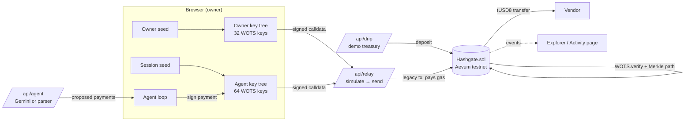
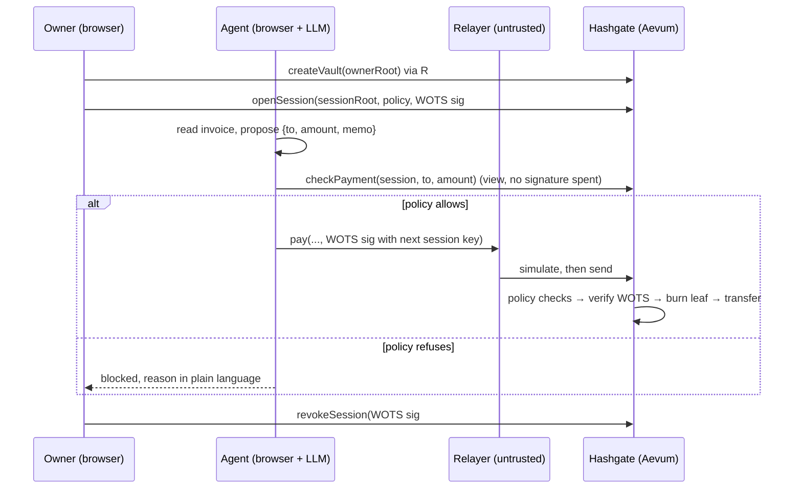

# Hashgate

**Post-quantum session keys for AI payment agents on QDay Aevum.**

Hashgate gives an AI agent a tUSD8 budget whose every spending decision is authorised by a
**hash-based one-time signature (WOTS) verified in Solidity**, not by ECDSA. The owner sets a
per-payment cap, a total budget, an expiry and a payee allowlist; the contract enforces them, and
the owner can revoke the agent instantly. Gas is paid by an untrusted relayer that can't change
anything it submits.

| | |
|---|---|
| Live demo | **https://hashgate-three.vercel.app** (no wallet needed) |
| Demo video | https://youtu.be/d-nyhSCl2Kw (2 min, narrated) |
| Pitch deck | https://hashgate-three.vercel.app/deck ([PDF](media/hashgate-deck.pdf)) |
| Contract | [`0x699d045bb5acfe677e7b0a44257eb4c9a5c73674`](https://explorer-test.qday.info/address/0x699d045bb5acfe677e7b0a44257eb4c9a5c73674) on Aevum testnet (chain 44005) |
| Track | Native AI Assistants (Aevum Builder Challenge #1) |

---

## Why

- **Agents hold keys that do too much.** Most agent wallets hand the model a private key or an
  ECDSA session key. A prompt injection or a leaked env var can move the whole balance.
- **ECDSA has an expiry date.** secp256k1 falls to Shor's algorithm on a large quantum computer
  ("Q-Day"). Every public key already on-chain can be harvested now and forged later.
- **QDay is a post-quantum chain.** Hashgate moves the authorisation itself onto hash-based
  signatures — no precompile or new opcode needed, it works on Aevum today.

Every other agent-guardrail design we know of still authorises the agent with ECDSA. Hashgate's
guardrails hold even against an attacker who has every ECDSA key in the system.

## What you can do in the demo

1. **Create a vault** — the browser derives 32 one-time owner keys from a fresh seed and commits
   their Merkle root on-chain. A demo treasury drips 0.05 tUSD8. No wallet, no gas.
2. **Open an agent session** — choose cap, budget, expiry, allowed payees. The owner signs the
   policy with one WOTS key (2,144-byte signature). The agent gets its own tree of 64 keys.
3. **Run the AI payables agent** over an inbox of four invoices. With *"assume the model is
   compromised"* on, it obeys a hidden instruction in one invoice. Result: two invoices paid,
   one over-cap invoice blocked (`OverPerPaymentCap`), the injected redirect blocked
   (`PayeeNotAllowed`). Any refusal can be signed and submitted to leave a reverted tx on the
   explorer.
4. **Try to break it** — the Q-Day drill forges a withdrawal of the whole vault as an attacker who
   holds every ECDSA key (`BadSignature`) and replays a real agent signature (`LeafAlreadyUsed`).
   Revoke the session and run the agent again (`SessionIsRevoked`).
5. **Activity** — every Hashgate event with explorer links.

## Architecture





### Contracts (`contracts/`)

- **`WOTS.sol`** — library. Winternitz OTS with n = 32 bytes, w = 16 (67 hash chains), keccak256
  with a per-call tweak `leaf<<16 | chain<<8 | step` (no multi-target attacks), leaf compression,
  and Merkle-path folding. Hand-written assembly with a scratch buffer: one signature check is
  ~1,000 keccak calls.
- **`Hashgate.sol`** — vaults and sessions. No admin, no ECDSA owner, no upgrades, `msg.sender`
  is never used for authorisation.

| Function | Signed by | What it does |
|---|---|---|
| `createVault(Key, salt)` | — | Commits an owner key tree. Signing nothing grants nothing. |
| `deposit` / `depositWithAuthorization` | ERC-20 approve / EIP-3009 | Funds a vault. The EIP-3009 nonce is bound to the vault id, so a relayer can't redirect it. |
| `openSession(vault, Key, Policy, OTS)` | owner key | Registers an agent key tree + cap / budget / expiry / payees. |
| `pay(session, to, amount, memo, OTS)` | agent key | Policy checks, then WOTS verify, burn the leaf, transfer. |
| `revokeSession(session, OTS)` | owner key | Kills the session immediately. |
| `withdraw(vault, to, amount, OTS)` | owner key | Moves funds out. |
| `rotateOwnerKey(vault, Key, OTS)` | owner key | Moves the vault to a fresh owner tree when keys run low. |
| `checkPayment(session, to, amount)` | view | Returns a reason code, so agents refuse before spending a key. |

Every digest includes a domain separator `keccak256("Hashgate v1", chainId, address(this))` and an
operation tag. Custom errors: `BadSignature`, `LeafAlreadyUsed`, `SessionIsRevoked`,
`SessionExpired`, `OverPerPaymentCap`, `OverBudget`, `PayeeNotAllowed`,
`InsufficientVaultBalance`, …

**Gas on Aevum** (measured, 1 gwei): `pay` ≈ 238k–270k, `openSession` ≈ 374k, `revokeSession`
≈ 176k, `createVault` ≈ 115k. A post-quantum agent payment costs about **0.0003 tQDAY**.

### SDK (`packages/sdk`, `@hashgate/sdk`)

Reusable TypeScript, independent of the web app:

```ts
import { KeyTree, randomSeed, domainOf, payDigest, verifyOTS, hashgateAbi, aevum } from "@hashgate/sdk";

const agent = KeyTree.fromSeed(randomSeed(), 6);          // 64 one-time keys
const key = agent.commitment();                          // { pubSeed, root, height } → openSession
const domain = domainOf(44005, HASHGATE);
const digest = payDigest(domain, sessionId, vendor, 5_000n, memo);
const ots = agent.sign(0, digest);                       // { leafIndex, sig (2,144 B), path }
verifyOTS(key, digest, ots);                             // true — same maths as WOTS.sol
// encodeFunctionData({ abi: hashgateAbi, functionName: "pay", args: [sessionId, vendor, 5_000n, memo, ots] })
```

It also exports the Aevum chain config, every digest builder, the ABI and plain-language error
text (`explainError`, `REASONS`).

### Web (`web/`, Next.js 15)

| Route | Purpose |
|---|---|
| `/` | What and why, live counters |
| `/console` | Vault, session, agent, drills, live log with explorer links |
| `/activity` | All Hashgate events (Blockscout log API, RPC fallback in 1,000-block windows) |
| `POST /api/relay` | `{ data, simulateOnly?, force? }` — decodes calldata, allows only Hashgate functions, simulates first and returns the decoded revert reason, then sends a legacy tx and waits for the receipt. Retries nonce races; rate-limited per IP. |
| `POST /api/agent` | `{ invoices: [{id, text}], compromised }` → proposed payments. One Gemini call per run with a model fallback chain; deterministic parser when no key or quota. |
| `POST /api/drip` | `{ vaultId }` → 0.05 tUSD8 into a brand-new empty vault, 5 per IP per day. |
| `GET /api/status` | Relayer gas, treasury and total locked. |

```bash
curl -s -X POST $URL/api/relay -H 'content-type: application/json' \
  -d '{"data":"0x…pay calldata…","simulateOnly":true}'
# {"ok":false,"stage":"simulation","fn":"pay","error":"PayeeNotAllowed","message":"This payee is not on the session's allowlist."}
```

## Run it yourself

Requirements: Node 22+. Foundry is optional (CI runs it).

```bash
git clone https://github.com/vibhanshu-s/hashgate && cd hashgate
npm install
npm test                 # compile (solc 0.8.24, Shanghai), SDK tests + contract e2e on an in-process EVM
cd contracts && forge install foundry-rs/forge-std --no-git && forge test -vv   # Foundry: unit, fuzz, TS↔Solidity vector
```

Run the app against the deployed contract:

```bash
cp web/.env.example web/.env.local     # fill in the values below
npm -w web run build && npm -w web run start
```

| Variable | Where | Meaning |
|---|---|---|
| `NEXT_PUBLIC_HASHGATE_ADDRESS` | public | `0x699d045bb5acfe677e7b0a44257eb4c9a5c73674` |
| `NEXT_PUBLIC_DEPLOY_BLOCK` | public | `3511774` |
| `RELAYER_PRIVATE_KEY` | server | A **fresh** test wallet with a little tQDAY (gas) and some tUSD8 (demo drips). Public anvil/hardhat keys are refused. |
| `GEMINI_API_KEY`, `GEMINI_MODEL` | server, optional | Invoice reading by Gemini; otherwise a deterministic parser. |
| `TRUSTED_IP_HEADER` | server | `x-vercel-forwarded-for` on Vercel. |

Deploy your own contract: `node tools/deploy.mjs` (reads `DEPLOYER_PRIVATE_KEY`), or
`forge script script/Deploy.s.sol --rpc-url aevum --broadcast --legacy --account <keystore>`.
Live smoke test of the whole flow: `node tools/smoke.mjs`.

## Testnet addresses and transactions

| | |
|---|---|
| Hashgate | [`0x699d045bb5acfe677e7b0a44257eb4c9a5c73674`](https://explorer-test.qday.info/address/0x699d045bb5acfe677e7b0a44257eb4c9a5c73674) |
| Deploy tx | [`0xa4171562…e8a6`](https://explorer-test.qday.info/tx/0xa41715621cce91ff2ad4777fdf8f34bca314e61e9107cf4697ed89952c76e8a6) (block 3511774) |
| tUSD8 | [`0x456569838f1d43009A91ebA4263147Afd7233483`](https://explorer-test.qday.info/address/0x456569838f1d43009A91ebA4263147Afd7233483) |
| createVault | [`0x2c293c2e…6c27`](https://explorer-test.qday.info/tx/0x2c293c2eed89e6ea7a9be56faa7c618ddd24cda956b584464f4b651f73c36c27) |
| deposit | [`0xb2cfcc93…2842`](https://explorer-test.qday.info/tx/0xb2cfcc93ad63ac3edda11fcf973f801b38eac60246f8098e99162fc652f72842) |
| openSession (WOTS-signed by owner) | [`0xd97227f0…d8f0`](https://explorer-test.qday.info/tx/0xd97227f0c1b98f8ba22d753ff0aef4cf8ef071f867def59e2f37c20e587bd8f0) |
| pay (WOTS-signed by agent) | [`0x8734757e…589a`](https://explorer-test.qday.info/tx/0x8734757e46c0457bf67c3613cd6120cac6a9ba7367028c484565aa7633da589a) |
| revokeSession | [`0x5cba7721…ef94`](https://explorer-test.qday.info/tx/0x5cba7721491f16adaba28b015ebddc02461a1a04e74d3917b12b29768427ef94) |

The explorer's contract verifier is not working yet (per the starter kit), so the source for the
deployed bytecode is this repo at the commit tagged `aevum-deploy-1`; `contracts/out/Hashgate.json`
holds the exact compiler output (solc 0.8.24, optimizer 200 runs, Shanghai).

## Security model

- **Authority** comes only from WOTS signatures over a domain-separated digest. A stolen relayer
  key, deployer key or user wallet key moves nothing out of a vault.
- **One-time keys** are burnt on-chain in a bitmap. The app never signs two different messages
  with one key: a key whose signature left the browser is never reused, even if its transaction
  failed. Agents check the policy with `checkPayment` before signing, so refusals cost no keys.
- **Least privilege**: the agent's key can only call `pay`, only within its session's cap, budget,
  expiry and allowlist. The owner key never leaves the browser.
- **Relayer** submits only allow-listed Hashgate calls, simulates first, rate-limits, and holds
  only a little tQDAY.
- **Prompt injection** is assumed, not prevented: the demo runs the agent as a compromised model
  and shows the chain refusing it.

## Known limits

- tUSD8 is an ECDSA-controlled token, and deposits come from ECDSA wallets. Hashgate protects
  funds once they are in the vault.
- WOTS keys are one-time: a session has a fixed number of payments (64 in the app, up to 4,096),
  and the owner tree must be rotated after 32 operations (`rotateOwnerKey`).
- Signatures are 2,144 bytes of calldata; ~270k gas per payment is fine on Aevum, not on L1.
- Seeds live in browser localStorage in this demo (download a backup). Production would keep the
  agent's seed in the agent's runtime and the owner's in a hardware or passkey-wrapped store.
- The relayer's rate limits are in memory per serverless instance.
- Assumes keccak256 remains a secure hash under quantum attack (Grover: ~128-bit preimage
  security at n = 256).

## Roadmap

1. **XMSS-style hypertree** so sessions can sign thousands of payments with small proofs.
2. **SPHINCS+-style stateless owner key** to remove leaf bookkeeping for rarely used owner keys.
3. **x402 / ERC-8004 adapter**: an agent identity whose payment authority is a Hashgate session.
4. **Native PQ precompile** on QDay mainnet: same API, lower gas.
5. **Merchant side**: invoices that carry a session-scoped pay request, and receipts for accounting.

Business model: Hashgate as agent-wallet infrastructure — a free SDK and contracts, with a hosted
relayer/policy service for teams running fleets of payment agents (per-payment fee or
subscription), launching with QDay mainnet.

## Developer feedback for QDay

- `eth_getLogs` is capped at 1,000 blocks; the Blockscout log API on the explorer has no cap and
  made the activity feed simple. Documenting that would help builders.
- Contract verification on the explorer is down; we publish compiler output in the repo instead.
- A native WOTS/SPHINCS+ verification precompile would cut PQ authorisation gas by an order of
  magnitude and make this pattern viable for every wallet on QDay.

## Tests

- `npm test`: SDK unit tests + full contract flow on an in-process Shanghai EVM — vault, deposit,
  EIP-3009 deposit bound to a vault, session, payment, payee / cap / budget / replay / forgery
  refusals, relayer with no authority, revoke, expiry, withdraw, owner-key rotation.
- `forge test`: the same rules in Foundry, fuzzing sign/verify, and a **cross-language vector**: a
  signature produced by the TypeScript SDK (`tools/vector.mjs`) verified by the Solidity library.
- `node tools/smoke.mjs`: the full flow against live Aevum testnet.

## Credits and licence

MIT, see [LICENSE](LICENSE). Network constants, the Shanghai opcode check and the deployment
conventions follow the [Aevum Starter Kit](https://github.com/qday-io/aevum-starter-kit) (MIT, PQA
Labs); no starter-kit code is copied. WOTS follows the construction in the XMSS (RFC 8391) and
SPHINCS+ literature, re-implemented over keccak256. Dependencies: viem (MIT), @noble/hashes (MIT),
Next.js (MIT), React (MIT), Tailwind CSS (MIT), solc-js (MIT), Hardhat (MIT, tests only),
forge-std (MIT/Apache-2.0, tests only).
